# haval-h6-cluster-media

**Media bridge for the 3rd-generation Haval H6 instrument cluster** — show now-playing
information from third-party music apps (QQ Music, Kuwo, Kugou, Ximalaya, …) on the
stock LCD cluster.


-3DDC84?logo=android&logoColor=white)


[简体中文](README.md) | [English](README.en.md)

---

## Why

On GWM V3 head units, the cluster media area only accepts the preinstalled
**爱趣听 (AI_QU_TING)** app, because `ThirdMediaPartyService` is a hard-coded
adapter for Tencent WeCarFlow with a single enum member.

However, the underlying `AptivMultiDisplayService` has **no source whitelist**:
any app can push media data through it, which then goes to the vehicle HAL and
on to the cluster over the QNX CAN gateway.

This project is a **companion app** that exploits that entry point:

- Does not modify, unpack or re-sign any third-party music app
- No root, no platform signature
- No changes to the head unit firmware
- Reads metadata only (title / artist / album / position); never touches audio

## How it works

```mermaid
flowchart LR
    A["Music app<br/>QQ Music (car) / Kuwo / Kugou / Ximalaya"] -->|"MediaSession<br/>or notification token"| B["haval-h6-cluster-media<br/>NotificationListenerService"]
    B -->|"notifyValue(propertyId, value)"| C["AptivMultiDisplayService<br/>android.uid.system"]
    C -->|"CarPropertyManager.setProperty"| D["Vehicle HAL"]
    D -->|"HISIP / TCP 192.168.10.1:5566"| E["QNX CAN gateway"]
    E --> F["Instrument cluster"]

    style B fill:#e3f2fd,stroke:#1976d2,stroke-width:2px
```



Two independent capture channels:

| Channel | Source | When it is used |
|---|---|---|
| A — session list | `MediaSessionManager.getActiveSessions(own notification listener)` | Normal case; full metadata and playback state |
| B — notification token | `Notification.EXTRA_MEDIA_SESSION` (`MediaSession.Token`) | When the session is missing from the list; builds a `MediaController` directly, or falls back to parsing the notification text |

Channel A uses the overload that takes your own notification-listener component,
so only **notification access** is required — not the signature-level
`MEDIA_CONTENT_CONTROL`. Channel B bypasses the "active session" check entirely.

See **[docs/architecture.md](docs/architecture.md)** (Chinese) for the full protocol,
property IDs and reverse-engineering notes.

## Compatibility

| Item | Value |
|---|---|
| Vehicle | 3rd-gen Haval H6 (same GWM V3 platform: Haval Dagou etc. likely works) |
| Head unit | GWM V3: Renesas R-Car H3, QNX Hypervisor 7.0, Android 9 (API 28, `hardware=gwmv3`) |
| Firmware | 4038 (4025 / 4028 / 4033 share the same architecture) |
| System deps | `aptiv.core.jar` on `BOOTCLASSPATH`, `AptivMultiDisplayService` |
| Permissions | Notification access only — no root, no platform signature |

Default target packages:

| App | Package |
|---|---|
| QQ Music (car edition) | `com.tencent.qqmusiccar` |
| Kuwo Music (car edition) | `cn.kuwo.kwmusiccar` |
| QQ Music (phone) | `com.tencent.qqmusic` |
| Kugou | `com.kugou.android` |
| Ximalaya | `com.ximalaya.ting.android` |

> On other vehicles/platforms the `aptiv.multidisplay` layer probably does not
> exist, so this app cannot be reused as-is. The MediaSession / notification-token
> capture code, however, is plain Android and can be reused.

## Quick start

```bash
adb install -r haval-h6-cluster-media-v1.2.apk

# grant notification access
adb shell cmd notification allow_listener \
    com.gwm.clusterbridge/.ClusterBridgeService
```

Then:

1. Open the app and check that it shows **“仪表通道：已连接”** (cluster channel connected).
2. Tap **“发送测试数据到仪表”** (send test data). The cluster should show
   `ClusterProbeTest / ProbeAlbum / ProbeArtist`. This verifies the transport
   without involving any music app.
3. Start playback in your music app. The cluster should follow title, artist and progress.

Logs:

```bash
adb logcat -s ClusterBridge ClusterPublisher
```

## Build

Requirements: JDK 8+, Android SDK (`platforms/android-28` + any `build-tools`
with aapt2/d8/zipalign/apksigner), Python 3.6+.

```bash
./build.sh          # Git Bash / WSL / macOS / Linux
build.bat           # Windows
python build_apk.py --clean   # equivalent
```

Output: `out/haval-h6-cluster-media-v1.2.apk`. The version is read from
`app/build.gradle`; a `debug.keystore` is generated automatically on first build.

Gradle is optional:

```bash
gradle wrapper --gradle-version 8.2
./gradlew assembleDebug
```

The `aptiv-stubs` module is `compileOnly`; its classes are **not** packaged into
the APK.

## Configuration

- **Target packages** — one per line; `*` captures every media session.
- **`sourceType`** — default `14` (the value used by the stock 爱趣听 app). The
  cluster uses it to pick a display style; unknown values may not render.

## Troubleshooting

| Symptom | Cause / fix |
|---|---|
| Stuck at “connecting” | `AptivMultiDisplayService` not up yet; the app retries 15 times |
| `notifyValue propertyId 18` logged but nothing on the cluster | `sourceType` not recognized; try `14` |
| `可见会话 0 个` (0 sessions) | No active media session; make sure the app is actually playing |
| Session visible but not taken over | Package name missing from the target list |
| Only “通知文本” and no “元数据” | Fallback channel; works, but no album/duration |
| Cluster flickers between sources | Fixed in v1.2 (single process-wide publisher) |

## Disclaimer

- Unofficial project. Not affiliated with or endorsed by GWM/Haval, Tencent,
  Kuwo, Kugou or Ximalaya. Trademarks belong to their respective owners.
- No firmware, system images, third-party APKs or copyrighted media are included.
- `aptiv-stubs` contains compile-time interface declarations only, written from
  publicly observable runtime behavior.
- Metadata is only read and forwarded; nothing is recorded or uploaded, and no
  DRM/copyright protection is bypassed.
- Installing third-party apps may affect your warranty. Use at your own risk and
  do not operate the app while driving.

## License

[MIT](LICENSE)
