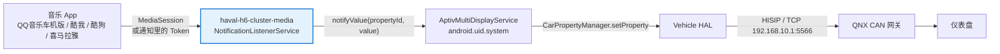

# haval-h6-cluster-media

**哈弗三代 H6 仪表媒体桥** —— 让 QQ音乐、酷我、酷狗、喜马拉雅等第三方音乐 App 的歌名/歌手/专辑显示在原厂液晶仪表盘上。


-3DDC84?logo=android&logoColor=white)


[简体中文](README.md) | [English](README.en.md)

---

## 目录

- [为什么需要它](#为什么需要它)
- [它是怎么工作的](#它是怎么工作的)
- [兼容性](#兼容性)
- [快速开始](#快速开始)
- [从源码构建](#从源码构建)
- [界面与配置](#界面与配置)
- [排错](#排错)
- [常见问题](#常见问题)
- [技术细节](#技术细节)
- [项目结构](#项目结构)
- [路线图](#路线图)
- [参与贡献](#参与贡献)
- [免责声明](#免责声明)
- [许可](#许可)

---

## 为什么需要它

哈弗三代 H6（长城 GWM V3 平台）的仪表盘媒体区**只认「爱趣听」**。
原因是车机里的 `ThirdMediaPartyService` 是一个为腾讯 WeCarFlow 写死的适配器，
组件枚举只有一个 `AI_QU_TING`，并没有通用框架。

好消息是：底层的 `AptivMultiDisplayService` 本身**没有来源白名单**，
任何 App 都能通过它把媒体信息写进 VHAL，再由 QNX CAN 网关送到仪表。

本项目就是利用这个入口的**伴侣 App**：

- 不修改 QQ音乐等第三方 App，不脱壳、不重签
- 不需要 root，不需要平台签名
- 不需要改动车机系统
- 只读取媒体元数据（歌名/歌手/专辑/进度），不接触音频数据

---

## 它是怎么工作的



采集有**两条互为备份的通道**：

| 通道 | 数据来源 | 何时生效 |
|---|---|---|
| A 会话列表 | `MediaSessionManager.getActiveSessions(自己的通知监听器)` | 常规情况，能拿到完整元数据与播放状态 |
| B 通知 Token | 媒体通知里的 `Notification.EXTRA_MEDIA_SESSION` | A 拿不到该会话时（部分车机版 App），直接建 `MediaController`；连 token 都没有则退回解析通知标题/正文 |

通道 A 用传入自己通知监听组件的重载，**只需要「通知使用权」**，
不需要 signature 级的 `MEDIA_CONTENT_CONTROL`。
通道 B 的 `new MediaController(context, token)` 不经过会话列表，也不受"活跃会话"判定影响。

更完整的协议、属性 ID 与逆向过程见 **[docs/architecture.md](docs/architecture.md)**。

---

## 兼容性

| 项目 | 实测 / 要求 |
|---|---|
| 车型 | 哈弗第三代 H6（同平台哈弗大狗等理论上通用，欢迎反馈） |
| 车机平台 | GWM V3：Renesas R-Car H3 + QNX Hypervisor 7.0 + Android 9（API 28，`hardware=gwmv3`） |
| 固件 | 4038（4025 / 4028 / 4033 同架构） |
| 系统依赖 | `aptiv.core.jar`（在 `BOOTCLASSPATH`）、`AptivMultiDisplayService` |
| 权限 | 仅需「通知使用权」，不需要 root / 平台签名 |
| 目标 App | 使用标准 MediaSession 的播放器均可（默认名单见下） |

**默认目标包名**：

| App | 包名 | 状态 |
|---|---|---|
| QQ音乐 车机版 | `com.tencent.qqmusiccar` | ✅ 已验证 |
| 酷我音乐 车机版 | `cn.kuwo.kwmusiccar` | ✅ 已验证 |
| QQ音乐 手机版 | `com.tencent.qqmusic` | ⚠️ 车机上通常装不上，仅作兼容 |
| 酷狗音乐 | `com.kugou.android` | ⚪ 标准 MediaSession，未实车验证 |
| 喜马拉雅 | `com.ximalaya.ting.android` | ⚪ 标准 MediaSession，未实车验证 |

> 换车/换平台时注意：`aptiv.multidisplay` 这层在其他车型上大概率不存在，本项目不能直接照搬；
> 但「MediaSession / 通知 Token 采集」部分是通用 Android 代码，可以复用。

---

## 快速开始

### 1. 准备 APK

两种方式任选：

- 从 [Releases](../../releases) 下载已构建的 APK（发布后才有效）
- 或按[从源码构建](#从源码构建)自行编译

### 2. 安装

```bash
adb install -r haval-h6-cluster-media-v1.2.apk
```

包名：`com.gwm.clusterbridge`。也可以用 U 盘或车机文件管理器安装。

### 3. 开启通知使用权

在车机上打开「仪表媒体桥」，点 **开启通知使用权** 跳到系统设置并勾选本应用；
或者直接用 adb：

```bash
adb shell cmd notification allow_listener \
    com.gwm.clusterbridge/.ClusterBridgeService
```

### 4. 先验证仪表通道（建议）

1. 确认界面顶部显示 **「仪表通道：已连接」**
2. 点 **「发送测试数据到仪表」**
3. 仪表应出现 `ClusterProbeTest / ProbeAlbum / ProbeArtist`

这一步不依赖任何音乐 App。如果它不通，说明该固件限制了第三方调用 MultiDisplay，
后续桥接也不会生效，请先看[排错](#排错)。

### 5. 播放音乐

打开 QQ音乐（或其他目标 App）播放任意歌曲，仪表应显示歌名/歌手，并随播放状态、进度变化。

```bash
adb logcat -s ClusterBridge ClusterPublisher
```

期望日志：

```
可见会话 1 个: com.tencent.qqmusiccar(PLAYING)"七里香"
已接管媒体会话: com.tencent.qqmusiccar（来源：会话列表）
元数据: 七里香 / 周杰伦 / 七里香
曲目已上报: 七里香 - 周杰伦 《七里香》
播放状态: 播放中
```

---

## 从源码构建

### 方式一：离线脚本（推荐，不需要 Gradle / 联网）

环境要求：

- JDK 8 及以上（`javac` / `keytool` 可用，或设置 `JAVA_HOME`）
- Android SDK：`platforms/android-28` + 任一 `build-tools`（含 aapt2、d8、zipalign、apksigner）
- Python 3.6+

```bash
# Git Bash / WSL / macOS / Linux
./build.sh

# Windows 命令行
build.bat

# 或直接
python build_apk.py --clean
```

脚本会自动探测 `ANDROID_SDK_ROOT`、`ANDROID_HOME`、`~/AppData/Local/Android/Sdk` 等常见位置。

产物：`out/haval-h6-cluster-media-v1.2.apk`（约 29 KB，用自动生成的调试证书签名）。

首次构建会在仓库根目录生成 `debug.keystore`（已被 `.gitignore` 忽略），不需要手动准备。

构建流程：

```
aapt2 compile → aapt2 link(+R.java) → javac(aptiv 存根 → 应用) → d8
              → 写入 classes.dex → zipalign → apksigner
```

版本号只在 `app/build.gradle` 维护，`build_apk.py` 会自动读取，不需要改两处。

### 方式二：Android Studio / Gradle

用 Android Studio 打开本目录即可（`settings.gradle` 已配置）。
命令行需要本机有 Gradle 8.2+：

```bash
gradle wrapper --gradle-version 8.2
./gradlew assembleDebug
```

> `aptiv.core` 的类在车机上由 boot classloader 提供，Gradle 侧通过 `compileOnly project(':aptiv-stubs')` 解析符号；
> 存根**不会**打进 APK（可自行用 `unzip -l` 确认 dex 里没有 `aptiv/*`）。

---

## 界面与配置

| 按钮 | 作用 |
|---|---|
| 保存配置 | 写入目标包名与 `sourceType`，重启通知监听后生效 |
| 开启通知使用权 | 跳转系统设置页 |
| 发送测试数据到仪表 | 不依赖音乐 App，验证通道是否打通 |
| 释放仪表音源占用 | 主动 ABANDON 当前音源，便于其他音源接管或卸载前清理 |
| 诊断信息 | 列出本机可见媒体会话 + 通知使用权状态 |
| 清空 | 清空界面日志 |

| 配置项 | 说明 |
|---|---|
| 目标 App 包名 | 每行一个；填 `*` 表示接管所有媒体会话 |
| `sourceType` | 默认 `14`（爱趣听实测值）。仪表按此决定显示样式，未知值可能不显示 |

老版本保存过默认配置的机器，升级后会自动把新增包名补进去；
只替换"原封未动"的默认值，用户自己改过的列表不会被覆盖。

---

## 排错

| 现象 | 原因与对策 |
|---|---|
| 界面一直「连接中」 | `AptivMultiDisplayService` 未启动。车机需完全开机；App 会自动重试 15 次 |
| 日志有 `notifyValue propertyId 18`，仪表无显示 | `sourceType` 不被仪表识别。换 14 试；或仪表本就不显示该字段 |
| 日志 `可见会话 0 个: 无` | 系统里没有活跃会话。确认目标 App 真的在播，且装的是车机版 |
| 会话里有目标包名，但没有「已接管」 | 包名没加进输入框。点「诊断信息」看实际包名，抄进输入框保存 |
| 只有「通知文本: …」没有「元数据: …」 | 走的是通知兜底通道，功能正常，但拿不到专辑/时长 |
| 元数据有但仪表不更新 | 目标 App 未处于 `STATE_PLAYING`；本 App 只在播放态推进度 |
| 仪表在多个音源间闪烁 | 之前版本两个 Publisher 互抢音源，v1.2 起已改为进程内单例；请确认装的是最新版 |
| 想彻底停用 | 关闭通知使用权；或点「释放仪表音源占用」再卸载 |

日志命令：

```bash
adb logcat -s MultiDisplay.Service ClusterBridge ClusterPublisher
```

常见关键字：

- `notifyValue propertyId 18` → Android 侧下发成功
- `notifyValue valueClass not match!` → 传入数据类型与 propertyId 不匹配
- `setProperty: car not connect exception` → VHAL 未连上（车机未启动完成）
- `SecurityException` / `avc: denied` → SELinux 拦截，该固件可能限制第三方调用，需改走改车机方案

---

## 常见问题

**需要 root 吗？会不会影响质保？**
不需要 root，也不改系统分区。但安装第三方 App、开启通知使用权属于对车机的改动，
是否影响质保请咨询经销商，风险自负。

**能同时桥接多个音乐 App 吗？**
会按包名分别建立控制器，但仪表同一时刻只有一个"当前音源"槽位，
实际显示取决于谁在播放/最后更新，属于预期行为。

**为什么没有专辑封面？**
当前版本只投送文本与进度。封面需要 `transferFile(sourceType, albumFileID, InputStream)`
与 `albumFileID` 配合，尚未实现，见[路线图](#路线图)。

**手机版 QQ音乐能用吗？**
车机上通常装不上或无法播放；默认名单里的 `com.tencent.qqmusic` 只是兼容项。
车机版包名是 `com.tencent.qqmusiccar`。

**升级后为什么配置没变？**
SharedPreferences 会跨版本保留。新增的默认包名会自动合并进"未修改过的默认列表"；
如果你手动改过，需要自己把新包名加进去。

**能把它做成车机预装 / 系统应用吗？**
可以，但需要平台签名和改分区，超出本项目范围；本项目刻意只做普通第三方 App。

---

## 技术细节

- **[docs/architecture.md](docs/architecture.md)** —— 完整链路、MultiDisplay 属性 ID 表、
  `sourceType` / 播放状态 / 音源动作取值、调用时序、权限链、`aptiv.core` 的 boot classpath 细节
- **[docs/ADDING_APPS.md](docs/ADDING_APPS.md)** —— 如何确认一个音乐 App 的包名并接入

几个容易踩的坑：

- `aptiv.core.jar` 在车机上只是空壳，真实类在 `boot-aptiv.core.vdex`（compact dex，常规工具读不了），
  所以必须自己写编译期存根，且**不能打进 APK**
- `MultiDisplayInterface.ConnectionCallback` 的回调名是 `onConncted()`（原厂拼写少一个 e），不要"修正"
- `propertyId` 是 MultiDisplay 内部 ID，服务内部会 `| 0x21709C00` 换算成 VHAL 属性
- `AptivMultiDisplayService` 以 system uid 写属性，**调用方 uid 不参与权限判定**

---

## 项目结构

```
haval-h6-cluster-media/
├── app/src/main/
│   ├── AndroidManifest.xml
│   ├── java/com/gwm/clusterbridge/
│   │   ├── MainActivity.java            # 界面：状态/配置/测试/诊断/日志
│   │   ├── ClusterBridgeService.java    # 通知监听 + 媒体信息桥接
│   │   ├── ClusterMediaPublisher.java   # 仪表投送出口（带自动重连）
│   │   ├── PublisherHolder.java         # 进程内单例（避免两个连接互抢音源）
│   │   └── UiLog.java                   # 界面日志缓冲
│   └── res/                             # 布局 / 字符串 / 图标
├── aptiv-stubs/src/main/java/aptiv/multidisplay/
│   ├── MultiDisplayInterface.java       # aptiv.core 编译期存根（不进 APK）
│   ├── AptivMultiDisplayManager.java
│   ├── MultiDisplayDataType.java
│   └── MultiDisplayPropertyIds.java
├── docs/                                # 架构与接入文档
├── build_apk.py                         # 离线构建脚本
├── build.sh / build.bat                 # 一键构建
└── settings.gradle / build.gradle       # Gradle 工程（可选）
```

---

## 路线图

- [ ] 专辑封面投送（`transferFile` + `albumFileID`）
- [ ] 多音源同时播放时的优先级策略
- [ ] 更多车机版音乐 App 的包名与实车反馈
- [ ] 界面英文化 / 多语言
- [ ] 属性编码与数据体的单元测试
- [ ] 更多固件版本（4025 / 4028 / 4033）兼容性确认

欢迎在 Issue 里补充实测结果。

---

## 参与贡献

请先读 **[CONTRIBUTING.md](CONTRIBUTING.md)**。
最有用的贡献是**实车测试反馈**：车型、固件版本、App 包名、`adb logcat` 片段。

提交前请确认：

- 不包含任何厂商固件、系统镜像、第三方 APK 或受版权保护的媒体内容
- 不提交 `build/`、`out/`、`debug.keystore`
- 新增第三方 App 包名时，说明是怎么确认的（例如 `aapt2 dump badging` 结果）

安全问题请按 **[SECURITY.md](SECURITY.md)** 的方式私下报告。

---

## 免责声明

- 本项目是**非官方**的个人项目，与长城汽车 / 哈弗、腾讯、酷我、酷狗、喜马拉雅等
  均无关联，未获其授权或背书。文中出现的商标、产品名归各自所有者。
- 仓库内**不包含**任何厂商固件、系统镜像、第三方应用安装包或受版权保护的媒体内容。
- `aptiv-stubs` 中的类仅为编译期接口声明，按运行时公开可观察的行为编写，不含厂商实现代码。
- 本项目只读取并转发媒体元数据，不录屏、不上传、不绕过任何版权保护机制。
- 在车机上安装第三方应用、修改系统设置可能影响质保或行车体验，**风险自负**。
  请勿在驾驶过程中操作；测试请由副驾完成。
- 请遵守你所在地区的法律法规及车辆使用条款。

## 许可

[MIT](LICENSE)
