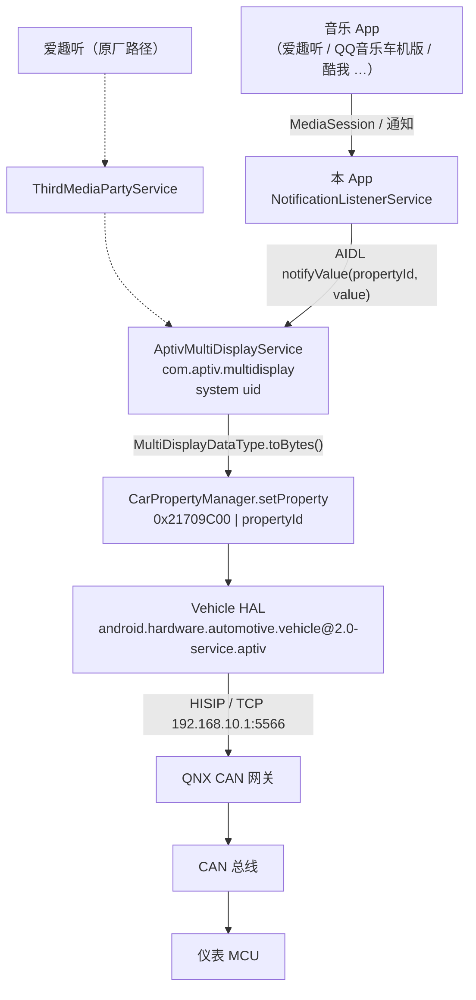

# 架构与协议

> 结论基于哈弗三代 H6、GWM V3 平台、`4038-usb` 固件（2024-12）的静态逆向与实车验证。
> 其他固件（4025 / 4028 / 4033）架构相同，细节可能略有差异。

## 1. 完整链路

仪表盘的媒体信息不是 App 直接往 CAN 上发，而是经过 Android 内部的
**MultiDisplay** 抽象层，最后由车机侧的 VHAL 转成 CAN 报文。



要点：

- Android 侧没有"直接给仪表发消息"的公开 API，唯一正规入口是
  `AptivMultiDisplayManager.notifyValue(propertyId, dataType)`。
- 原厂的 `ThirdMediaPartyService` 只是把爱趣听的数据翻译成 MultiDisplay 数据体，
  它不参与权限判定，也不是必需的中间层。

## 2. 为什么原厂"只支持爱趣听"

`ThirdMediaPartyService` 里有一个第三方媒体源枚举
`com.aptiv.thirdmediaparty.components.ComponentsType$ComponentsEnum`，
**只有一个成员** `AI_QU_TING`。它的实现类通过腾讯 WeCarFlow 的 FusionSDK 订阅：

```
mediaInfo | playState | activeState | audioFocusChange | progressChange
```

也就是说，"只支持爱趣听"是**适配层写死**，不是 MultiDisplay 本身的限制。
`AptivMultiDisplayService` 没有来源白名单，`onBind` 直接返回 binder，
`notifyValue` 只做数据类型匹配检查。

## 3. 客户端 API

```java
package aptiv.multidisplay;

public class MultiDisplayInterface {
    public MultiDisplayInterface(Context ctx, ConnectionCallback cb);
    public void connect();
    public AptivMultiDisplayManager getManager();

    public interface ConnectionCallback {
        void onConncted();      // 原厂拼写就是少一个 e，不要"修正"
        void onDisconnect();
    }
}

public class AptivMultiDisplayManager {
    public void notifyValue(int propertyId, Object value);
    public void transferFile(int sourceType, int fileId, InputStream in);
}
```

服务 action：`com.aptiv.multidisplay.start`。

`aptiv.core` 同时声明了两个 protected-broadcast：
`multidisplay.notify.currentsource.request` / `.response`。

### 3.1 为什么可以只写存根

`/system/framework/aptiv.core.jar` 在车机上**只是一个空壳**（仅 MANIFEST），
真正的类在 `/system/framework/boot-aptiv.core.vdex`（compact dex，`dexdump`/jadx 读不了）。
同时 `aptiv.core.jar` 被写进了 `init.rc` 的 `BOOTCLASSPATH`：

```
export BOOTCLASSPATH ...:/system/framework/android.car.jar:/system/framework/aptiv.core.jar
```

因此：

- **运行时**：`aptiv.multidisplay.*` 由 boot classloader 提供给所有 App，无需 `uses-library`。
- **编译时**：需要一个能提供符号的 jar。本工程用 `aptiv-stubs` 模块，
  通过 `compileOnly` 引入，**不会打进 APK**（可用 `unzip -l` 确认 dex 里没有 `aptiv/*`）。

存根里只有方法签名，没有任何实现代码。

## 4. 属性 ID

`propertyId` 是 MultiDisplay 内部 ID，不是 VHAL 属性 ID。
`AptivMultiDisplayService` 内部会做 `propertyId | 0x21709C00` 换算后再 `setProperty`。

从 `AptivMultiDisplayService.<clinit>` 的 SparseArray 初始化可还原 **52 项**，
媒体相关的部分：

| ID | 数据类型 | 含义 |
|---:|---|---|
| 1 | `InfotainmentCurrentSource` | 当前音源 + 音源动作（请求 / 放弃） |
| 3 | `InfotainmentInterruptSource` | 音源打断 |
| 5 | `InfotainmentAllData` | 全量状态（音源 + 打断 + 媒体） |
| 16 | `MediaDeviceStatus` | 媒体设备状态（可播 / 不可播） |
| 17 | `MediaPlayStatus` | 播放状态 |
| 18 | `MediaTrackInfo` | 曲目信息（歌名 / 专辑 / 歌手 / 封面 ID） |
| 19 | `MediaPlayTime` | 播放进度（已播 / 总时长，秒） |
| 20 | `MediaPlayingMode` | 循环 / 随机 |
| 21 | `RadioChannelInfo` | 收音机频道 |
| 22 | `OnlineRadioChannelInfo` | 在线电台频道 |

## 5. 数据体与取值

### 5.1 数据结构

```java
MultiDisplayDataType.InfotainmentCurrentSource cur =
        new MultiDisplayDataType.InfotainmentCurrentSource();
cur.setCurrentSource(sourceType);
cur.setSourceAction(sourceAction);
mgr.notifyValue(1, cur);

MultiDisplayDataType.MediaTrackInfo info = new MultiDisplayDataType.MediaTrackInfo();
info.setSourceType(sourceType);
info.setSongName(title);
info.setAlbumName(album);
info.setArtistName(artist);
info.setAlbumFileID(albumFileId);
mgr.notifyValue(18, info);

MultiDisplayDataType.MediaPlayStatus st = new MultiDisplayDataType.MediaPlayStatus();
st.setSourceType(sourceType);
st.setPlayStatus(playStatus);
mgr.notifyValue(17, st);

MultiDisplayDataType.MediaPlayTime tm = new MultiDisplayDataType.MediaPlayTime();
tm.setSourceType(sourceType);
tm.setPlayTime(elapsedSec);
tm.setTotalTime(totalSec);
mgr.notifyValue(19, tm);
```

### 5.2 重载陷阱

`setSourceType` / `setPlayStatus` / `setSourceAction` 各有 **int 版**和**枚举版**两个重载：

- int 版：`ThirdMediaPartyService`、`MediaService` 在用
- 枚举版：`GwmMedia` 在用，注意 `setPlayStatus` 的枚举参数类型是
  **`PlaybackModeEnum`**（不是 `PlayStatusEnum`）

本工程统一用 int 版，不依赖枚举序号。

### 5.3 sourceType

`SourceTypeEnum` 中已确认存在的枚举：

```
SOURCE_INVALID
SOURCE_USBAUDIO
SOURCE_USBVIDEO
SOURCE_IPOD
SOURCE_CARBITMEDIA     ← 网络音乐（酷我 Carbit）走这个
```

**爱趣听实际下发的 sourceType = 14**（`components/aiquting/a` 中
`const/16 v1, #int 14` 后调用 `updateNowPlayingTrackInfo`）。

仪表可能按 sourceType 决定图标与字段，未知值可能不显示。
所以本工程默认复用 **14**。若数据到了但仪表空白，第一个要怀疑的就是它。

### 5.4 播放状态

| 值 | 含义 |
|---:|---|
| 1 | 播放中 |
| 2 | 暂停 |
| -1 | 无效 |

### 5.5 音源动作

`SourceActionEnum`：`SOURCE_ACTION_INVALID` / `SOURCE_ACTION_ABANDON` / `SOURCE_ACTION_REQUEST`。
在 `NotifyInfoToCluster` 中对应常量：

| 值 | 含义 |
|---:|---|
| 1 | REQUEST（声明占用当前音源） |
| 2 | ABANDON（释放） |

## 6. 权限模型

逐层拆解从第三方 App 到 VHAL 的关卡：

| # | 关卡 | 结论 | 依据 |
|---|---|---|---|
| 1 | `AptivMultiDisplayService.onBind` | 无 permission 校验 | 字节码只有 `iget-object` + `return-object` |
| 2 | `aptiv.core` 客户端 | 无 uid / permission 校验 | 全量字符串搜索 `getCallingUid` / `checkCallingPermission` / `enforceCallingPermission` → 0 命中 |
| 3 | SELinux 能否 bind | 可以 | `multidisplay_service` 属 `appdomain`；`(allow appdomain appdomain (binder (call transfer)))`，`untrusted_app` 也在 appdomain 内 |
| 4 | 真正写 VHAL 的调用者 | **system uid** | `AptivMultiDisplayService` 是 `sharedUserId=android.uid.system`，由 AOSP `CarPropertyService.checkAccess` 放行 |
| 5 | VHAL 属性级写权限 | 正常 | VHAL 里的 `Property 0x%x has no write access` 是**属性级**权限，不是调用者权限 |

**核心推论：** 真正执行 `setProperty` 的始终是 system uid 的
`AptivMultiDisplayService`，第三方 App 只是把数据交给它。
**调用者 uid 在这条链路上不参与判定。**

实车已验证：普通第三方 App 调用 `notifyValue(18, ...)` 后仪表出现测试数据，
`logcat -s MultiDisplay.Service` 中可见 `notifyValue propertyId 18`。

## 7. 读取任意 App 的 MediaSession

`MediaSessionManager` 有两个重载，权限要求完全不同：

| 方法 | 权限 |
|---|---|
| `getActiveSessions()` | `MEDIA_CONTENT_CONTROL`（signature 级，第三方拿不到） |
| `getActiveSessions(ComponentName)` **传自己的通知监听器** | 只需**通知使用权** |

第二个重载校验的是 `isEnabledNotificationListener()`，是 Android 给通知监听器
预留的正当通道。

### 7.1 通知 Token 兜底

实测发现：即使目标 App 在正常播放，`getActiveSessions()` 也可能不把它列出来
（Android 9 只返回它认为"活跃"的会话，车机版 App 的播放器常跑在独立进程里）。

媒体通知一定带着 `Notification.EXTRA_MEDIA_SESSION`（`MediaSession.Token`），
而 `new MediaController(context, token)` **不经过会话列表，也不受激活状态判定影响**，
且不需要额外权限。本工程在 `onNotificationPosted` / `onListenerConnected` 时都会从通知里捞 token。

如果连 token 都没有，则退回解析通知的 `EXTRA_TITLE` / `EXTRA_TEXT` / `EXTRA_SUB_TEXT` / `EXTRA_PROGRESS`，
功能可用但拿不到专辑与准确时长。

## 8. 封面图

`MediaTrackInfo.albumFileID` 只是 ID，图片要走：

```java
mgr.transferFile(sourceType, albumFileId, inputStream);
```

原厂做法是先把封面下载到内存，再 `transferFile(14, fileID, stream)`。
**本工程尚未实现**，见 README 的路线图。

## 9. 备选方案与取舍

| 方案 | 做法 | 改动量 | 结论 |
|---|---|---|---|
| **A. 伴侣 App** | 通知监听 + 直接调 MultiDisplay | 一个 App | ✅ 本项目采用 |
| B. 自研播放器 | 自己播放 + 自己投送 | 一个 App | ✅ 可行，但需自建曲库 |
| C. 改 `ThirdMediaPartyService` | 加一个通用广播组件 | 反编译 + 平台签名 + 刷机 | ⚠️ 需平台密钥，门槛高 |
| D. 魔改 QQ音乐 | 脱壳 + 注入 + 重签 | 大 | ❌ 破坏登录与升级，且涉及第三方版权，不做 |
| E. 劫持 FusionSDK | 伪装成 WeCarFlow 服务 | 大 | ❌ 需实现腾讯私有协议 |

方案 C 的关键障碍：`ThirdMediaPartyService` 与 `AptivMultiDisplayService` 都是
`sharedUserId=android.uid.system`，重打包必须用平台密钥，普通用户拿不到。

## 10. 已知限制

- 仪表同一时刻只有一个"当前音源"槽位，多 App 同时播放时显示谁取决于最后更新者。
- 未实现封面投送。
- `sourceType` 只验证过 14；其他值在仪表侧的呈现未系统性测试。
- 进度只在播放态推进，暂停/缓冲时不会校正。
- 只在 4038 固件上实车验证。

## 11. 验证方法

```bash
# 1. MultiDisplay 服务在跑
adb shell ps -A | grep -i multidisplay

# 2. Android 侧是否下发成功
adb logcat -s MultiDisplay.Service ClusterBridge ClusterPublisher
#   notifyValue propertyId 18 ...            → 下发成功
#   notifyValue valueClass not match!        → 数据类型不匹配
#   setProperty: car not connect exception   → VHAL 未连上

# 3. VHAL 侧
adb logcat | grep -iE "propertyId: 0x21|multidisplay"
```

本工程界面里的「发送测试数据到仪表」就是这套验证的可视化版本：
不依赖任何音乐 App，直接投送 `ClusterProbeTest`。
